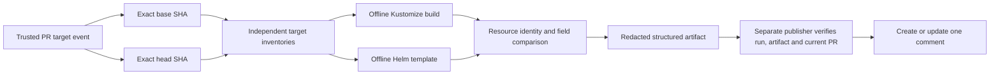

# Kubernetes Manifest Semantic Diff

See what a Helm or Kustomize pull request changes in the rendered Kubernetes objects. One PR comment groups changes by application and environment, shows field-level diffs, and redacts Secret values. For example, changing a production Helm value from `100m` to `250m` appears under the affected Deployment’s CPU request. Reformatting the values file produces a clean review. [See a review on GitHub](https://github.com/charalamposlamprou/kubernetes-manifest-semantic-diff/pull/1#issuecomment-7063159011)

## Use as a reusable GitHub Actions workflow

In the repository that holds your manifests, save the following caller as **`.github/workflows/kustomize-diff.yaml`**. Keep that filename because the publisher verifies the caller’s workflow path before commenting. [Download the caller YAML](examples/consumer-workflow.yaml)

```yaml
name: Kubernetes manifest review

on:
  pull_request_target:
    types: [opened, reopened, synchronize]

permissions: {}

jobs:
  review:
    permissions:
      contents: read
      actions: read
      pull-requests: write
    uses: charalamposlamprou/kubernetes-manifest-semantic-diff/.github/workflows/kustomize-diff.yaml@fd585c9f4a55550eb48fe050d29c48568db1f12b
```

1. Enable GitHub Actions and allow the repository to call this public workflow. The job uses the caller’s built-in `GITHUB_TOKEN`. Comparison needs read access to the repository. Publication reads the run artifact and writes the PR comment.
2. Merge the caller into your default branch. The engine discovers local Helm charts and Kustomize overlays automatically. If you deploy a chart with environment-specific values or need to select particular overlays, add a root inventory. [Configure the deployment inventory](#configure-the-deployment-inventory)
3. Open a pull request that changes a chart, values file, or overlay. The bot posts the rendered changes and updates the same comment when you push another commit. A render error identifies the affected target and fails the check.

The example pins the workflow, engine, and publisher with one commit SHA. To upgrade, update the SHA after `@` to a reviewed commit that supports `workflow_call`. The caller works on GitHub.com with GitHub-hosted Ubuntu runners and requires no custom secrets or cluster credentials.

## How a review works



The review workflow runs on opened, reopened and synchronize events. Each target renders independently on both sides. A missing target counts as an inventory change, even if it renders zero objects. A failed target contributes a diagnostic and no resource counts. Other successfully rendered targets can still report changes. A configuration error invalidates the inventory comparison. The publishing job marks incomplete comparisons as failed after posting the diagnostic.

## Try the sample

Use Python 3.12 or newer and install Helm **4.1.1** and Kustomize **5.8.1** on your path. The native mode in this example is for trusted local trees. Outputs go to stdout. Raw renderer diagnostics stay private.

```sh
git clone https://github.com/charalamposlamprou/kubernetes-manifest-semantic-diff.git
cd kubernetes-manifest-semantic-diff
python3.12 -m venv .venv
. .venv/bin/activate
python -m pip install -e .
base=$(mktemp -d)
git archive HEAD | tar -x -C "$base"
git apply examples/review.patch
manifest-diff --native "$base" .
git apply -R examples/review.patch
```

The patch changes the production backend's replica count and image tag, and the production payments container's CPU request. Development and staging use the same bases and retain their original settings. All Secret inputs in the samples are deliberately fictitious.

For isolated rendering, run `bash ci/build-renderers.sh` on a Linux amd64 Docker host. Pass two exported revision directories without Git metadata to `manifest-diff BASE_DIR HEAD_DIR`. The default mode uses the locally built scratch image. Each invocation receives one read-only revision mount, a bounded memory-backed temporary directory, and no network. Use clean exports for local comparisons, especially when working directories might contain credentials.

## Configure the deployment inventory

Place `.manifest-diff.yaml` at the root. Target names are stable comparison keys. Set `application` and `environment` to group a review. The default application label is the target name. The default environment is `default`.

```yaml
version: 1
sensitivePaths:
  - /metadata/annotations/example.com~1credential
  - /spec/template/spec/containers/*/env/*/value
targets:
  - name: backend-production
    type: kustomize
    application: backend
    environment: production
    path: examples/backend/overlays/production

  - name: payments-production
    type: helm
    application: payments
    environment: production
    chart: examples/payments
    release: payments
    namespace: production
    values:
      - examples/payments/values.yaml
      - examples/environments/production/payments.yaml
    kubeVersion: "1.32.0"
    apiVersions: [networking.k8s.io/v1]
    clusterScoped: [platform.example.com/Region]
```

| Option | Behavior |
|---|---|
| `type`, `name` | Required. Choose `helm` or `kustomize` and a unique stable name. |
| `chart`, `path` | Repository-relative chart or kustomization directory respectively. |
| `values` | Repository-relative files, in override order. Later files win. |
| `release`, `namespace` | Helm defaults to the target name and namespace `default`. For both tools, namespace supplies the comparison namespace when a namespaced object omits one. Kustomize namespace transformations belong in the kustomization. |
| `kubeVersion`, `apiVersions` | Helm capability inputs. Default Kubernetes version is `1.32.0`. API entries extend Helm's built-in capabilities. |
| `clusterScoped` | Target-local `group/Kind` entries for external cluster-scoped CRDs. CRDs included in the render supply their own scope. |
| `sensitivePaths` | Absolute JSON pointers into individual objects. A segment of `*` matches one key or list index. Use `~1` for a literal slash and `~0` for a tilde. The policy is the union of both revisions. |
| `targets: []` | An explicitly empty inventory. Automatic discovery stays disabled. |

Without a config, discovery looks for `kustomization.yaml`, `kustomization.yml`, `Kustomization`, and `Chart.yaml`. It follows local Kustomize resource/base/component references to exclude referenced bases, excludes components as standalone targets, and skips library and vendored Helm subcharts. Disjoint deployable roots become separate targets. Overlapping roots, name collisions, cycles, and competing kustomization filenames require an explicit selection or a repository fix. Declare an inventory when a repository also contains independent examples, fixtures or charts that should stay out of deployment reviews. Renaming a target appears as a removal and an addition.

## Renderer and comparison behavior

- Kustomize uses its built-in generators, components, patch and transformation pipeline with root-only load restrictions. Local directory references between overlays and bases work. Generator suffixes and updated consumer references are visible in the diff.
- Helm renders local charts, vendored dependencies in `charts/`, CRDs and hook definitions. No hook runs. Vendor dependencies before committing and supply fixed capability inputs. Two consecutive Helm renders must agree after mapping and document ordering are normalized. Templates depending on the clock, random values or live lookups are unsuitable for reproducible reviews.
- Resources match within each target by API group, kind, effective namespace and name. The complete API version participates in comparison. A same-group served-version migration appears as an `apiVersion` field change. A group or kind migration appears as removal and addition. Duplicate logical identities fail that target. Core `v1/List` objects expand into their members.
- Built-in cluster kinds and rendered CRD scope control namespace handling. For an external custom kind with no scope declaration, the engine assumes namespaced scope. Explicit namespaces on known cluster-scoped objects fail validation.
- Mappings and resource document order are insignificant. Named regular containers, volumes and named Service ports match by name. Init containers and environment entries match by name and report relative order changes. Their execution or expansion can depend on order. Duplicate or missing list keys fall back to positional comparison. Commands, arguments, CR lists and other unclassified lists compare positionally. Kubernetes quantity spellings, equivalent RBAC rule formulations and schema defaults can therefore produce review differences.
- Secret `data` and `stringData` values and a Secret's last-applied annotation are protected in memory before the report is built. Changed fields show `[redacted]` on both sides. Secret key names, object identity and resource counts remain reviewable. A repeated known sensitive literal in another displayed field is also suppressed. Apply explicit paths to application-specific credentials. A transformed credential intentionally placed into an unrelated public field requires its own redaction policy.

## Trust and permissions

| Job | Token permissions | Inputs and responsibilities |
|---|---|---|
| Compare | `contents: read` | Check out trusted engine code and exact PR snapshots separately. Verify both checkout SHAs, detach Git metadata, and run the engine from the trusted directory. |
| Publish | `contents: read`, `actions: read`, `pull-requests: write` | Fetch the trusted publisher and one exact same-run artifact. Verify run, attempt, workflow path/ID, repository, artifact ID/name, SHA-256 digest, PR number, base/head SHAs and current open PR. |
| Engine tests | `contents: read` | Test trusted main pushes or manual dispatch. |

There are no PR-controlled shell fragments, Helm plugins, post-renderers, dependency downloads, external Kustomize plugins, repository scripts or cluster credentials in the rendering path. The scratch image contains two checksum-pinned binaries. Docker drops capabilities, disables its log driver, caps CPU, memory, processes and runtime, and gives the non-root user a read-only root filesystem. Rendered stdout is bounded and processed in memory. Stderr is discarded because renderer errors can quote Secrets.

Only the versioned redacted JSON envelope is uploaded, with one-day retention. The publisher reads a single bounded `report.json` ZIP member in memory, validates the schema, builds bounded Markdown itself and encodes untrusted text. It never extracts to a filesystem. The workflow serializes runs per PR, skips superseded heads, and updates only comments owned by the GitHub Actions bot with the exact marker. User-authored lookalikes are left alone. Repeated execution with an identical body needs no write.

## Example review

Applying `examples/review.patch` produces the following review. The file headers identify normalized render outputs for each target and resource. GitHub highlights additions and removals inside each expanded section. Hunk line numbers refer to the normalized YAML. Large resources can fall back to a field-only diff, and protected rotations identify the changed field.

### Kubernetes Manifest Semantic Diff

**Summary**

| Change | Count |
|---|---:|
| Added | 0 |
| Modified | 2 |
| Removed | 0 |

**Result** · 2 resource changes.

#### <code>backend</code> / <code>production</code> · <code>backend-production</code>

<details open><summary>Modified · <code>Deployment.apps</code> / <code>production</code> / <code>backend</code></summary>

```diff
--- a/rendered/backend-production/production/Deployment.apps/backend.yaml
+++ b/rendered/backend-production/production/Deployment.apps/backend.yaml
@@ -4,7 +4,7 @@
   name: backend
   namespace: production
 spec:
-  replicas: 3
+  replicas: 4
   selector:
     matchLabels:
       app: backend
@@ -23,7 +23,7 @@
         envFrom:
         - configMapRef:
             name: backend-settings-hf678c7m2b
-        image: ghcr.io/example/backend:1.0.0
+        image: ghcr.io/example/backend:1.1.0
         name: backend
         ports:
         - containerPort: 8080
```

Field paths · <code>spec.replicas</code>, <code>spec.template.spec.containers&#91;backend&#93;.image</code>

</details>

#### <code>payments</code> / <code>production</code> · <code>payments-production</code>

<details open><summary>Modified · <code>Deployment.apps</code> / <code>production</code> / <code>payments</code></summary>

```diff
--- a/rendered/payments-production/production/Deployment.apps/payments.yaml
+++ b/rendered/payments-production/production/Deployment.apps/payments.yaml
@@ -30,5 +30,5 @@
             cpu: 500m
             memory: 256Mi
           requests:
-            cpu: 100m
+            cpu: 250m
             memory: 128Mi
```

Field paths · <code>spec.template.spec.containers&#91;payments&#93;.resources.requests.cpu</code>

</details>

An unchanged render says **No semantic changes found in rendered resources.** Oversized output falls back to counts and a notice. RBAC, Secret, NetworkPolicy and security-context changes carry a security-sensitive label. Review the field changes to determine whether access expanded or contracted.

## Development and validation

```sh
python -m pip install --require-hashes -r ci/dev.lock
ruff check .
ruff format --check .
pytest --cov=manifest_diff --cov-report=term-missing
actionlint
python -m build
```

Install `build` separately for the optional package build. Tests invoke the pinned native Helm and Kustomize executables and exercise embedded chart dependencies, hooks, CRDs, overlays, ordered values, discovery, normalization, redaction, artifact validation, comment reconciliation, and an exhaustive 28-point requirements matrix. Main CI additionally runs the Docker production path and checksum-verified actionlint 1.7.12. Regenerate dependency locks using `uv pip compile --universal --python-version 3.12 --generate-hashes` on the respective `.in` files.

The [integration tests](tests/test_integration.py) exercise real charts and overlays. The [behavior matrix](tests/test_coverage_matrix.py) covers 28 review scenarios, and the [publisher tests](tests/test_publish.py) cover artifact provenance and comment updates.

## Troubleshooting and limits

| Symptom | Check |
|---|---|
| Incomplete comparison | The report identifies the revision and target or inventory. Validate local paths and syntax. For a trusted checkout, run the corresponding pinned renderer privately to inspect its detailed error. |
| Helm dependency missing | Commit the dependency archive or unpacked dependency chart under the parent chart's `charts/` directory. |
| Unexpected namespace or CR identity | Set the target namespace, include its CRD, or declare the external cluster-scoped kind. Manifests using only `generateName` lack a stable identity and fail comparison. |
| Publisher fails | Verify Actions and PR permissions, artifact availability, the workflow filename, trusted checkouts and current PR revisions. Rerun the full workflow to produce a fresh attempt-bound artifact. |
| Discovery includes an example | Declare deployment targets explicitly. Deployment intent cannot be inferred from arbitrary repository layout. |
| Review is abbreviated | A comment is capped below 60,000 UTF-8 bytes. Details are bounded to 512 resource records, 256 field records per resource and a shared text budget. Counts still cover successful targets. Split a large review by application. |
| Input rejected | Keep revisions within 60,000 inventory entries, 128 targets, 8 MiB of rendered output per invocation, 60 seconds per render and bounded YAML depth/node count. Use JSON-compatible YAML with unique string keys and expanded aliases. Visible repository-relative config paths keep untrusted input inside its snapshot. |

These are offline rendered comparisons. Live admission mutation, server-side defaulting and conversion, cluster-specific API schemas, controller reconciliation, runtime drift, and external secret resolution can change the applied result. A periodic Helm value can also agree across two quick renders and vary later. Independent targets can intentionally contain the same resource. Counts are per target. Offline diffing does not establish whether a deployment will succeed.
